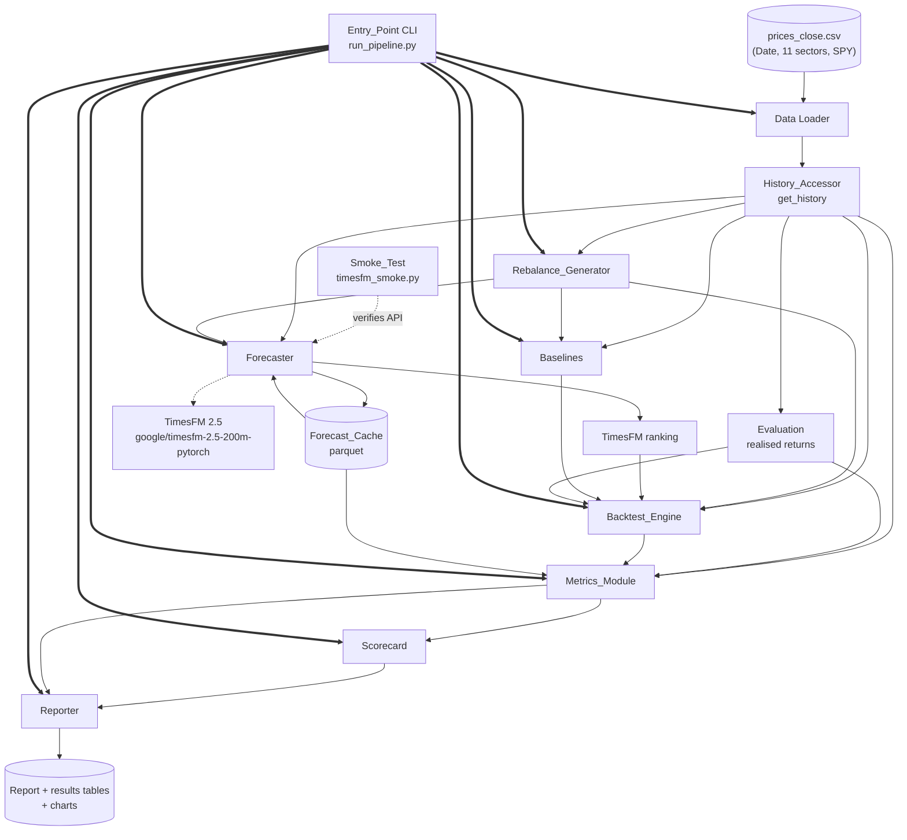

# Design Document

## Overview

This document designs a research-grade backtesting pipeline that tests one narrow question: can TimesFM 2.5, used zero-shot, rank 11 SPDR equity sector ETFs by their expected 20-trading-day return better than cheap baselines, after transaction costs? The pipeline produces a reproducible, evidence-based Go / Conditional / No-Go recommendation against nine pre-agreed success criteria drawn from `docs/sow.md` (Sections 4, 6, 7).

The design is driven by three priorities, in strict order:

1. **Look-ahead safety.** Every price read in the entire pipeline flows through a single function, `get_history(ticker, decision_date)`, which returns only observations dated on or before the decision date. No other component slices a price dataframe by any other means. Two mandated unit tests enforce this.
2. **Reproducibility.** Fixed random seeds for every stochastic operation, a single entry-point command, a resumable parquet forecast cache, pinned `requirements.txt`, and a documented README. Two runs over the same inputs and cache produce byte-identical scorecard metrics and pass/fail results.
3. **Faithful implementation of the SOW.** The nine success criteria, the scorecard, and the Go / Conditional / No-Go decision rule are implemented exactly as specified, using the documented sequential interpretation in Requirement 9.

The pipeline is authored in this workspace but executed exclusively in Google Colab; Python cannot run on the developer's machine. Nothing in the design requires local execution of tests or local installation of packages. A negative result (No-Go) is an explicitly valid outcome.

### Key design decisions

| Decision | Rationale |
| --- | --- |
| Single `get_history` accessor as the only price-read path | Enforces look-ahead safety structurally rather than by convention; testable in isolation (Req 2). |
| TimesFM called zero-shot, log-price input, 512 context / 20 horizon | Mirrors the SOW model choice and the official TimesFM 2.5 example; no fine-tuning or covariates (Req 4). |
| Parquet forecast cache keyed by `(ticker, decision_date)`, committed one decision date at a time with atomic writes | Makes the ~1,000-forecast run resumable and reproducible; an interrupted run leaves each decision date fully cached or absent, never partial (Req 4, 11). |
| Forecasts batched per decision date (one model call over all eligible sector tickers) | Fewer, larger TimesFM calls per date; the natural atomic cache unit is a whole decision date (Req 4.9, 4.11, 4.12, 4.13). |
| Realised returns live in a dedicated `evaluation.py`, used only by backtest and metrics | Concentrates the only forward-looking price read in one module that runs after all signals are formed; keeps the Forecaster and Baselines strictly point-in-time (Req 2.4, 2.9). |
| Portfolio gross returns use simple 20-day returns (`exp(log_return) - 1`); log returns used only for IC and interval calibration | Weighted portfolio returns compose correctly in simple-return space; ranking/calibration stay in log-return units (Req 6, 7.1, 7.8). |
| "top-3 portfolio" = long-only top-3 equal-weight everywhere in scoring | Removes ambiguity; long-short is a secondary view excluded from scorecard and recommendation (Req 7.12, 8.12). |
| Expected return derived as step-20 log-price forecast minus last observed log price | Converts TimesFM's log-price forecast into a comparable 20-day log return for ranking and calibration (Req 4.7, 4.8). |
| Net Sharpe annualised by `sqrt(252/20)` | Correct scaling for non-overlapping 20-trading-day holding periods (Req 7.3). |
| Smoke-test script built first | Verifies the TimesFM API and Colab environment before any pipeline code is written (Req 1). |

## Architecture

### Component diagram



### End-to-end data flow

1. **Load.** The Data Loader reads `prices_close.csv` into an in-memory price table indexed by date with one column per ticker (11 sectors + SPY). It performs validation only (no slicing).
2. **Accessor.** The `History_Accessor` wraps the loaded table and exposes `get_history(ticker, decision_date)`. Every downstream read uses it.
3. **Rebalance dates.** The `Rebalance_Generator` derives the trading calendar from the table's dates and produces 80-100 non-overlapping decision dates spaced 20 trading positions apart, starting on the first trading day on or after 1 July 2019.
4. **Forecasts.** For each decision date the `Forecaster` assembles the eligible sector tickers' log-price context arrays (via the accessor) and issues a single batched TimesFM 2.5 zero-shot call (512 context / 20 horizon, one input array per ticker). It writes all of that date's point/p10/p90 log-price forecasts to the parquet `Forecast_Cache` atomically as one unit. Fully cached dates are skipped. The expected 20-day return and p10/p90 20-day returns are derived from the log-price forecasts.
5. **Rankings.** The TimesFM ranking (by expected 20-day return) and each baseline ranking (equal-weight, SPY, 20-day momentum, 60-day momentum, 1,000 random) are formed per decision date, strictly point-in-time via the accessor.
6. **Evaluation (realised returns).** After all forecasts and signals are formed, the `Evaluation` module computes realised 20-day returns from the forward price at `next_date` (20 trading days later): a simple return (`exp(log_return) - 1`) for the backtest and a log return for the metrics. This is the only component permitted to read forward prices, and it is used only by the Backtest_Engine and the Metrics_Module.
7. **Backtest.** The `Backtest_Engine` forms long-only top-3 (and secondary long-short) portfolios, holds 20 trading days, and computes portfolio gross returns as the weighted sum of per-sector simple 20-day returns from the Evaluation module, then turnover and transaction costs at 5 bps and 10 bps, recording gross and net returns.
8. **Metrics.** The `Metrics_Module` computes IC and its t-statistic (using realised log returns from Evaluation), net Sharpe, max drawdown, net excess returns, random-null percentile, interval calibration, and sub-period splits.
9. **Scorecard + recommendation.** The `Scorecard` evaluates the nine criteria against their thresholds; the `Reporter` applies the sequential decision rule and emits exactly one Go / Conditional / No-Go recommendation with a per-criterion rationale, plus the report, charts, and results tables.

The entire sequence runs from one CLI command (`run_pipeline.py`) with no manual steps between stages.

## Components and Interfaces

All functions carry type hints on every parameter and return value and a docstring (Req 11.7). Signatures below use `pandas`, `numpy`, and standard typing. Dates are `pandas.Timestamp`.

### 0. Smoke-test script (first deliverable) — `src/timesfm_smoke.py`

Standalone script; not imported by the pipeline. Verifies the TimesFM 2.5 API and the Colab environment before the pipeline is built (Req 1).

```python
SMOKE_TICKER: str = "XLK"  # fixed, hard-coded so selection is identical across runs

def run_smoke_test(prices_csv_path: str) -> int:
    """Load TimesFM 2.5, forecast 20 days for one fixed ETF from its most recent
    512 log-price context points, and verify the API end to end. Return 0 on
    success, non-zero on failure.

    On success the script:
      - prints the point forecast (20 values), p10 (20 values), and p90 (20 values);
      - prints the wall-clock forecast time in seconds (>=2 decimals);
      - prints the integer context length used (<=512);
      - prints the quantile_forecast shape (expected (1, 20, 10));
      - asserts p10 <= point <= p90 at a majority of the 20 forecast steps, to
        confirm the quantile-channel layout (index 1 = q10, 5 = median, 9 = q90);
      - confirms that `infer_is_positive` is a valid ForecastConfig field (present
        in the ForecastConfig signature / accepted by the constructor) before the
        pipeline relies on it.

    On model-load or forecast failure, print an error naming the failed step
    ('model load' or 'forecast') and return a non-zero status."""
```

API call sequence (verified against Google's official repo; do not substitute names):

```python
import inspect
import timesfm
from timesfm import TimesFM_2p5_200M_torch, ForecastConfig

# Pre-flight: confirm infer_is_positive is a real ForecastConfig field before use.
assert "infer_is_positive" in inspect.signature(ForecastConfig).parameters

model = TimesFM_2p5_200M_torch.from_pretrained("google/timesfm-2.5-200m-pytorch")
model.compile(
    ForecastConfig(
        max_context=512,
        max_horizon=20,
        normalize_inputs=True,
        use_continuous_quantile_head=True,
        infer_is_positive=False,  # log prices / returns can be negative
    )
)
point_forecast, quantile_forecast = model.forecast(
    horizon=20,
    inputs=[log_price_array],  # list of 1-D float arrays, one per series
)
# quantile_forecast shape: (n_series, horizon, 10); index 1 = q10, 5 = median, 9 = q90
print(quantile_forecast.shape)  # expected (1, 20, 10) for a single-series smoke run
# Majority-of-steps ordering check confirms the q10/point/q90 channel layout:
p10 = quantile_forecast[0, :, 1]
p90 = quantile_forecast[0, :, 9]
assert ((p10 <= point_forecast[0]) & (point_forecast[0] <= p90)).mean() > 0.5
```

Context handling: use the most recent 512 trading days of log prices; where fewer than 512 exist, use all available and print the integer context length used (Req 1.3, 1.7).

### 1. Data Loader — `src/data.py`

```python
def load_prices(csv_path: str) -> pandas.DataFrame:
    """Load the close-price CSV into a DataFrame indexed by parsed Date (ascending),
    one float column per ticker (11 sectors + SPY). Validate that required tickers
    are present. Does NOT slice by date; slicing happens only in History_Accessor."""
```

### 2. History_Accessor — `src/history.py`

The single interface for all price reads (Req 2, steering rule #1).

```python
class HistoryAccessor:
    def __init__(self, prices: pandas.DataFrame) -> None:
        """Wrap the loaded price table. This is the only object permitted to
        slice price data by date."""

    def get_history(self, ticker: str, decision_date: pandas.Timestamp) -> pandas.Series:
        """Return the price series for `ticker` containing only observations whose
        date is <= decision_date, in ascending date order, with empty/NaN prices
        excluded. Raise KeyError naming the ticker if it is absent. Return an empty
        Series if no observation satisfies the conditions."""
```

Invariants enforced: returned `max(index) <= decision_date`; ascending order; no NaN; no partial data for missing tickers.

### 3. Rebalance_Generator — `src/rebalance.py`

```python
def trading_calendar(prices: pandas.DataFrame) -> list[pandas.Timestamp]:
    """Ordered distinct trading dates present in the input data."""

def generate_rebalance_dates(
    calendar: list[pandas.Timestamp],
    start_date: pandas.Timestamp = pandas.Timestamp("2019-07-01"),
    horizon: int = 20,
) -> list[pandas.Timestamp]:
    """Decision dates beginning on the first calendar date on or after start_date,
    each 20 calendar positions after the previous, including only dates with at
    least 20 trading dates strictly after them. Expected to yield 80-100 dates."""

def eligible_tickers(
    accessor: "HistoryAccessor",
    universe: list[str],
    decision_date: pandas.Timestamp,
    min_history: int = 252,
) -> list[str]:
    """Universe tickers with >= 252 non-missing observations on/before the date
    (handles XLC joining late)."""
```

### 4. Forecaster + Forecast_Cache — `src/forecast.py`

The Forecaster forecasts the 11 sector tickers that make up the ranking universe; SPY is the benchmark and is not forecast. The unit of work and the unit of cache commit is one decision date covering all of that date's eligible sector tickers, batched into a single model call.

```python
LOG_PRICE: str = "log_price"

@dataclass(frozen=True)
class ForecastRecord:
    ticker: str
    decision_date: pandas.Timestamp
    context_points: int
    point_log: list[float]   # 20 step-wise log-price point forecasts
    p10_log: list[float]     # 20 step-wise q10 log-price forecasts
    p90_log: list[float]     # 20 step-wise q90 log-price forecasts
    last_log_price: float    # last observed log price at decision_date

class ForecastCache:
    def __init__(self, cache_path: str) -> None:
        """Parquet-backed cache at a run-time configurable path (may be a Google
        Drive path). Each row is a forecast uniquely keyed by (ticker,
        decision_date); records are committed one decision date at a time."""

    def contains_date(self, decision_date: pandas.Timestamp,
                      tickers: list[str]) -> bool:
        """True only if every expected ticker for this decision date is already
        cached, i.e. the decision date is FULLY cached. Used to skip whole dates."""

    def get(self, ticker: str, decision_date: pandas.Timestamp) -> "ForecastRecord | None": ...

    def put_date(self, decision_date: pandas.Timestamp,
                 records: list["ForecastRecord"]) -> None:
        """Commit all of a decision date's ticker records atomically as one unit
        (write the updated table to a temp file, then replace), only after every
        record for that date is complete. An interrupted run therefore leaves a
        decision date either fully cached or entirely absent — never partial."""

    def all_records(self) -> pandas.DataFrame: ...

class Forecaster:
    def __init__(self, accessor: "HistoryAccessor", cache: "ForecastCache",
                 model: object, context: int = 512, horizon: int = 20) -> None: ...

    def forecast_date(self, decision_date: pandas.Timestamp,
                      tickers: list[str]) -> list["ForecastRecord"]:
        """Batch all eligible sector tickers for one decision date into a single
        model call. For each ticker, pull history via get_history, convert to log
        prices, and take the most recent 512 points (or all if fewer, recording
        context_points). Issue ONE model.forecast(horizon=20, inputs=[...]) call
        whose inputs list has one log-price context array per ticker. Return one
        ForecastRecord per ticker (point/p10/p90 log-price forecasts and
        last_log_price)."""

    def run(self, decision_dates: list[pandas.Timestamp],
            universe: list[str]) -> None:
        """Iterate decision dates in generation order. For each date, determine the
        eligible sector tickers, skip the date if it is already FULLY cached
        (cache.contains_date), otherwise call forecast_date and commit the whole
        date at once via cache.put_date. Resumable: a rerun recomputes only the
        decision dates not already fully cached."""

def expected_return(record: "ForecastRecord") -> float:
    """Step-20 point log-price forecast minus last observed log price (Req 4.7)."""

def p10_return(record: "ForecastRecord") -> float:
    """Step-20 p10 log-price forecast minus last observed log price (Req 4.8)."""

def p90_return(record: "ForecastRecord") -> float:
    """Step-20 p90 log-price forecast minus last observed log price (Req 4.8)."""
```

### 5. Baselines — `src/baselines.py`

```python
def equal_weight(eligible: list[str]) -> dict[str, float]:
    """Equal weight over all eligible sectors; weights sum to 1."""

def spy_buy_and_hold() -> dict[str, float]:
    """Hold only SPY across the full period."""

def momentum_ranking(
    accessor: "HistoryAccessor", eligible: list[str],
    decision_date: pandas.Timestamp, lookback: int, universe: list[str],
) -> list[str]:
    """Rank eligible sectors by trailing `lookback`-day return (descending);
    ties broken deterministically by universe ticker order. Sectors lacking
    `lookback` observations are excluded."""

def momentum_top3(accessor, eligible, decision_date, lookback, universe) -> list[str]:
    """Top 3 from momentum_ranking."""

def random_rankings(
    eligible_by_date: dict[pandas.Timestamp, list[str]],
    n_strategies: int = 1000, seed: int = 0,
) -> list[list[list[str]]]:
    """1,000 simulated strategies; each draws a fresh random ordering of eligible
    sectors at every decision date (fixed seed for reproducibility)."""
```

### 6. Evaluation module (realised returns) — `src/evaluation.py`

The single source of realised 20-day returns. It is used ONLY by the Backtest_Engine (which needs simple returns for portfolio gross returns) and the Metrics_Module (which needs log returns for IC and interval calibration). It is NEVER imported by the Forecaster or the Baselines, which remain strictly point-in-time via `get_history`. Because realised returns require a forward price, this module reads prices up to `next_date` (20 trading days after the decision date) via the accessor using `next_date` as the as-of date. This forward read is permitted ONLY here, in evaluation, which runs after all forecasts and signals for every decision date have been formed.

```python
def realised_log_return(
    accessor: "HistoryAccessor", ticker: str,
    decision_date: pandas.Timestamp, next_date: pandas.Timestamp,
) -> float:
    """20-day realised LOG return: log price at next_date minus the last observed
    log price at decision_date. Reads the forward price via get_history(ticker,
    next_date). Used by the Metrics_Module for IC and interval calibration."""

def realised_simple_return(
    accessor: "HistoryAccessor", ticker: str,
    decision_date: pandas.Timestamp, next_date: pandas.Timestamp,
) -> float:
    """20-day realised SIMPLE return: exp(realised_log_return(...)) - 1. Used by
    the Backtest_Engine to compute portfolio gross returns."""
```

Both read forward prices only through the accessor; no other price-read path exists. `realised_simple_return` is defined in terms of `realised_log_return`, so the two are always consistent (`simple = exp(log) - 1`).

### 7. Backtest_Engine — `src/backtest.py`

```python
LONG_ONLY: str = "long_only"
LONG_SHORT: str = "long_short"

def long_only_weights(ranking: list[str]) -> dict[str, float]:
    """Top 3 at +1/3 each; long weights sum to 1."""

def long_short_weights(ranking: list[str]) -> dict[str, float]:
    """Top 3 at +1/3, bottom 3 at -1/3; net exposure 0, gross exposure 2."""

def turnover(prev_weights: dict[str, float], new_weights: dict[str, float]) -> float:
    """Sum of absolute per-sector weight differences; prior weights 0 on the first
    decision date."""

@dataclass(frozen=True)
class PeriodResult:
    strategy: str
    decision_date: pandas.Timestamp
    gross_return: float    # SIMPLE-return based: sum over held sectors of
                           # weight * (exp(sector_log_return) - 1)
    turnover: float
    cost_bps: int          # 5 or 10
    transaction_cost: float
    net_return: float      # gross_return - transaction_cost

def run_backtest(
    accessor, rankings_by_strategy, decision_dates, next_dates,
    cost_levels: tuple[int, int] = (5, 10),
) -> pandas.DataFrame:
    """Form portfolios, hold 20 trading days, and record gross/turnover/cost/net
    per strategy, date, and cost level. Portfolio gross return is the weighted sum
    of per-sector SIMPLE 20-day returns obtained from evaluation.realised_simple_return
    (the Backtest_Engine performs no price reads of its own for realised returns).
    Net return = gross_return - cost, where cost = cost_bps * turnover. Raise a
    ValueError naming the date and eligible count if too few sectors exist."""
```

### 8. Metrics_Module — `src/metrics.py`

```python
def spearman_ic(forecast_returns: dict[str, float],
                realised_returns: dict[str, float]) -> float:
    """Per-date Spearman rank IC between forecast and realised 20-day LOG returns.
    Realised log returns are obtained from evaluation.realised_log_return."""

def mean_ic(ics: list[float]) -> float: ...

def ic_tstat(ics: list[float]) -> float:
    """mean IC / standard error; undefined (NaN) if fewer than two ICs."""

def net_sharpe(net_returns: list[float]) -> float:
    """mean/std annualised by sqrt(252/20); undefined (NaN) if std == 0."""

def max_drawdown(net_returns: list[float]) -> float:
    """Largest peak-to-trough decline of cumulative net return; a fraction in
    [0, 1]."""

def net_excess_return(strategy_net: list[float], benchmark_net: list[float]) -> float:
    """Difference in cumulative net return over the full period."""

def random_percentile(timesfm_sharpe: float, random_sharpes: list[float]) -> float:
    """Share of random Sharpes <= TimesFM Sharpe, on a 0-100 scale."""

def interval_calibration(records: pandas.DataFrame,
                         realised_by_key: dict[tuple[str, pandas.Timestamp], float]) -> float:
    """Share in [0, 1] of (ticker, date) pairs whose realised 20-day LOG return
    (from evaluation.realised_log_return) falls at or inside [p10_return,
    p90_return]."""

def subperiod_splits(per_date: pandas.DataFrame) -> dict[str, dict]:
    """IC and net excess return for first half, second half (middle date to the
    second half when odd), and most recent 24 calendar months."""
```

### 9. Scorecard — `src/scorecard.py`

```python
@dataclass(frozen=True)
class CriterionResult:
    number: int
    name: str
    metric_value: float | str
    threshold: str
    passed: bool
    note: str  # e.g. "required metric unavailable"

def evaluate_scorecard(metrics: "MetricsBundle") -> list[CriterionResult]:
    """Evaluate all nine criteria against thresholds using the long-only top-3
    equal-weight portfolio as the 'top-3 portfolio'. A criterion whose required
    metric is unavailable is recorded as fail with an explanatory note."""
```

### 10. Reporter — `src/report.py`

```python
def recommend(scorecard: list["CriterionResult"], metrics: "MetricsBundle") -> tuple[str, str]:
    """Apply the sequential decision rule (Go; else No-Go; else Conditional) and
    return (recommendation, rationale). Rationale names each contributing
    criterion by number with its pass/fail result."""

def build_report(scorecard, recommendation, rationale, metrics,
                 output_dir: str) -> None:
    """Write the results report (scorecard table, recommendation, caveats) and
    charts: equity curve, IC-over-time, interval calibration, plus the last-24-
    months view. Save per-strategy metrics and scorecard tables to files."""
```

### 11. Entry_Point CLI — `run_pipeline.py`

The single entry point parses its arguments with `argparse`, so the full pipeline runs from one command with configurable paths and seed (Req 11.1, 4.10).

```python
import argparse

def main(
    prices_csv: str = "data/prices_close.csv",
    cache_path: str = "forecast_cache.parquet",
    output_dir: str = "outputs",
    seed: int = 0,
) -> None:
    """Run every stage end to end with no manual steps: load -> rebalance dates
    -> forecasts (resumable, per-decision-date batched) -> baselines -> backtest
    -> metrics -> scorecard -> report. Reuse all cached forecasts. Produce the
    scorecard, report, and results tables as artifacts."""

def parse_args(argv: list[str] | None = None) -> argparse.Namespace:
    """Parse CLI flags: --prices-csv, --cache-path, --output-dir, --seed."""
    parser = argparse.ArgumentParser(
        description="Run the TimesFM sector-rotation backtest end to end."
    )
    parser.add_argument("--prices-csv", default="data/prices_close.csv")
    parser.add_argument("--cache-path", default="forecast_cache.parquet")
    parser.add_argument("--output-dir", default="outputs")
    parser.add_argument("--seed", type=int, default=0)
    return parser.parse_args(argv)

if __name__ == "__main__":
    args = parse_args()
    main(
        prices_csv=args.prices_csv,
        cache_path=args.cache_path,
        output_dir=args.output_dir,
        seed=args.seed,
    )
```

Example Colab invocation pointing the cache at Google Drive (see Configuration and Reproducibility):

```
!python run_pipeline.py --cache-path /content/drive/MyDrive/timesfm_cache.parquet
```

## Data Models

### Price table (in memory)
- Index: `DatetimeIndex` (ascending, distinct trading dates).
- Columns: `XLK, XLF, XLE, XLV, XLI, XLY, XLP, XLU, XLB, XLRE, XLC, SPY` (float; NaN where no data, e.g. early XLC).

### Forecast cache (parquet) — one row per `(ticker, decision_date)`

| Column | Type | Meaning |
| --- | --- | --- |
| `ticker` | str | sector or benchmark ticker |
| `decision_date` | date | rebalance date (part of unique key) |
| `context_points` | int | number of log-price context points used (<=512) |
| `point_log_20` | float | step-20 log-price point forecast |
| `p10_log_20` | float | step-20 q10 log-price forecast |
| `p90_log_20` | float | step-20 q90 log-price forecast |
| `point_log_path` | list[float] | full 20-step point path (for charts/audit) |
| `p10_log_path` | list[float] | full 20-step q10 path |
| `p90_log_path` | list[float] | full 20-step q90 path |
| `last_log_price` | float | last observed log price at `decision_date` |

Derived (not stored; computed on read):
- `expected_return = point_log_20 - last_log_price`
- `p10_return = p10_log_20 - last_log_price`
- `p90_return = p90_log_20 - last_log_price`

These are 20-day log returns, the same units used for realised returns and interval calibration.

### Returns / weights table (per period, per strategy)

| Column | Type |
| --- | --- |
| `strategy` | str (e.g. `timesfm_long_only`, `equal_weight`, `spy`, `mom20`, `mom60`, `timesfm_long_short`) |
| `decision_date` | date |
| `weights` | dict[str, float] |
| `gross_return` | float (simple-return based: weighted sum of per-sector `exp(log_return) - 1`) |
| `turnover` | float |
| `cost_bps` | int (5 or 10) |
| `transaction_cost` | float |
| `net_return` | float (`gross_return - transaction_cost`) |

### Metrics bundle

Holds per-strategy net Sharpe, max drawdown, per-date and mean IC with t-statistic (TimesFM, mom20, mom60), net excess returns vs equal-weight and SPY at 5 and 10 bps, the 1,000 random net Sharpes and the TimesFM percentile, interval calibration, and the first-half / second-half / last-24-months splits.

### Scorecard record
One `CriterionResult` per criterion (number, name, metric value, threshold, pass/fail, note), plus the recommendation string and rationale.

### Derivations and formulas

- **Expected 20-day return (ranking signal):** `point_log_20 - last_log_price` (Req 4.7).
- **p10 / p90 20-day returns (calibration band):** `p10_log_20 - last_log_price` and `p90_log_20 - last_log_price` (Req 4.8).
- **Realised 20-day LOG return (IC + calibration):** `evaluation.realised_log_return` = log price 20 trading days after the decision date minus the last observed log price at the decision date (Req 7.8), read via the accessor. Used only by the Metrics_Module for IC and interval calibration.
- **Realised 20-day SIMPLE return (backtest):** `evaluation.realised_simple_return` = `exp(realised_log_return) - 1`. Used only by the Backtest_Engine.
- **Portfolio gross return per period:** `sum over held sectors of weight * (exp(sector_log_return) - 1)`, i.e. the weighted sum of per-sector simple 20-day returns (Req 6.1, 6.2). IC and interval calibration continue to use 20-day log returns.
- **Net Sharpe:** `mean(net_return) / std(net_return) * sqrt(252 / 20)`; undefined when `std == 0` (Req 7.3, 7.10). Operates on the simple-return-based net returns.
- **Max drawdown:** largest peak-to-trough decline of the cumulative net-return series, as a fraction in `[0, 1]` (Req 7.4). Operates on the simple-return-based net returns.
- **IC t-statistic:** `mean_ic / (std(ics) / sqrt(n))`; undefined when `n < 2` (Req 7.1, 7.11).
- **Random null distribution:** 1,000 simulated strategies, each drawing a fresh random ordering of eligible sectors at every decision date, forming a top-3 portfolio, yielding one net Sharpe each — 1,000 values forming the null (Req 5.7). The TimesFM percentile is the share `<=` the TimesFM net Sharpe on a 0-100 scale (Req 7.6).

## Correctness Properties

*A property is a characteristic or behavior that should hold true across all valid executions of a system — essentially, a formal statement about what the system should do. Properties serve as the bridge between human-readable specifications and machine-verifiable correctness guarantees.*

This pipeline is well suited to property-based testing: most of its core is pure functions over numeric inputs (log-return derivations, momentum ranking, turnover, Sharpe, drawdown, IC, interval calibration) plus deterministic threshold logic (scorecard, decision rule) and a structural look-ahead invariant. Each property below is tagged with the requirements it validates and is implemented by a single property-based test running at least 100 iterations.

### Property 1: History accessor never returns future data

*For any* price table and *any* decision date, every observation returned by `get_history` has a date less than or equal to the decision date, and no observation dated after the decision date is present.

**Validates: Requirements 2.2, 2.5**

### Property 2: Returned history is ascending and NaN-free

*For any* price table and decision date, the series returned by `get_history` is sorted in ascending date order and contains no empty or NaN price value.

**Validates: Requirements 2.3, 2.6**

### Property 3: Forecaster reads prices only through the accessor

*For all* forecast computations, the Forecaster obtains its input price series exclusively through `get_history` and performs no other price read.

**Validates: Requirements 2.4, 2.9, 4.1**

### Property 4: Rebalance dates are non-overlapping with sufficient look-ahead

*For any* trading calendar, each consecutive pair of generated decision dates is exactly 20 trading-calendar positions apart, and every generated decision date has at least 20 trading dates strictly after it.

**Validates: Requirements 3.3, 3.4**

### Property 5: Forecast-return derivation is consistent and order-preserving

*For any* forecast record, the expected, p10, and p90 20-day returns equal the corresponding step-20 log-price forecast minus the last observed log price; and whenever `p10_log_20 <= point_log_20 <= p90_log_20`, the derived returns satisfy `p10_return <= expected_return <= p90_return`.

**Validates: Requirements 4.7, 4.8**

### Property 6: Forecast cache is idempotent and resumable at decision-date granularity

*For any* set of decision dates, running the forecast loop a second time over the same cache computes no new forecast for any fully cached decision date and leaves every previously cached record unchanged; and committing a decision date is atomic, so each date is either fully present (all its ticker records) or entirely absent — never partial.

**Validates: Requirements 4.11, 4.12, 4.13, 11.8**

### Property 7: Equal-weight baseline forms a valid simplex

*For any* non-empty eligible sector set, the equal-weight baseline assigns every sector the same weight and the weights sum to 1.

**Validates: Requirements 5.1**

### Property 8: Momentum ranking is descending with deterministic tie-breaking

*For any* set of eligible sectors and trailing returns and *any* lookback (20 or 60), the momentum ranking orders sectors by descending trailing return, breaks ties by universe ticker order, and selects the same top 3 on repeated runs over identical input.

**Validates: Requirements 5.3, 5.4, 5.5, 5.8**

### Property 9: Insufficient-history sectors are excluded from rankings

*For any* price table and decision date, any sector with fewer than the required observations (252 for eligibility, or the lookback for a momentum baseline) is absent from the corresponding ranking.

**Validates: Requirements 3.5, 5.6**

### Property 10: Random baseline is reproducible under a fixed seed

*For any* fixed seed, two generations of the random-ranking baseline produce identical orderings at every decision date, and the baseline yields exactly 1,000 simulated strategies.

**Validates: Requirements 5.7, 5.9, 11.4**

### Property 11: Long-only portfolio weights sum to 1

*For any* ranking of at least three eligible sectors, the long-only portfolio assigns +1/3 to each of the top 3 and the weights sum to 1.

**Validates: Requirements 6.1**

### Property 12: Long-short portfolio is dollar-neutral with gross exposure 2

*For any* ranking of at least six eligible sectors, the long-short portfolio assigns +1/3 to each top-3 sector and -1/3 to each bottom-3 sector, so net exposure is 0 and gross exposure is 2.

**Validates: Requirements 6.2**

### Property 13: Turnover equals summed absolute weight changes

*For any* prior and new weight vectors, turnover equals the sum of the absolute per-sector weight differences; when there are no prior weights (first decision date), it equals the sum of the absolute new weights.

**Validates: Requirements 6.4, 6.5**

### Property 14: Transaction cost is linear in bps and turnover

*For any* turnover value and *any* cost level, the transaction cost equals the cost level (in bps) times the turnover, and the 10 bps cost is exactly twice the 5 bps cost.

**Validates: Requirements 6.6, 6.7**

### Property 15: Net Sharpe formula with zero-variance guard

*For any* non-constant per-period net-return series, net Sharpe equals the mean divided by the standard deviation times `sqrt(252/20)`; *for any* constant series the standard deviation is 0 and net Sharpe is reported as undefined.

**Validates: Requirements 7.3, 7.10**

### Property 16: Max drawdown is a bounded peak-to-trough fraction

*For any* net-return series, maximum drawdown is a non-negative fraction between 0 and 1, and a strictly non-decreasing cumulative-return series yields a drawdown of 0.

**Validates: Requirements 7.4**

### Property 17: Information coefficient bounds, concordance, and t-stat guard

*For any* paired forecast and realised return vectors, the Spearman IC lies in `[-1, 1]`, equals 1 for an identical ranking and -1 for a fully reversed ranking; and the IC t-statistic is reported as undefined whenever fewer than two per-date ICs are available.

**Validates: Requirements 7.1, 7.2, 7.11**

### Property 18: Random percentile is a bounded monotone share

*For any* set of random net Sharpes and *any* candidate value, the percentile is on a 0-to-100 scale, equals the share of random values less than or equal to the candidate, and is non-decreasing in the candidate value.

**Validates: Requirements 7.6**

### Property 19: Interval calibration is a bounded inside-band share

*For any* set of `(ticker, decision_date)` records with realised returns, the calibration value lies in `[0, 1]`; it equals 1 when every realised 20-day return falls at or inside its p10-to-p90 band and 0 when none does.

**Validates: Requirements 7.8**

### Property 20: Sub-period halves partition the decision dates

*For any* ordered list of decision dates, the first half and second half together contain every date exactly once, and the second half receives the middle date when the count is odd (so its size is greater than or equal to the first half's).

**Validates: Requirements 7.9**

### Property 21: Scorecard pass/fail matches each threshold predicate

*For any* metrics bundle, each of the nine criteria is marked pass if and only if its SOW threshold predicate holds (using the long-only top-3 equal-weight portfolio as the "top-3 portfolio"), and a criterion whose required metric is unavailable is marked fail.

**Validates: Requirements 7.12, 8.1, 8.2, 8.3, 8.4, 8.5, 8.6, 8.7, 8.8, 8.9, 8.11, 8.12**

### Property 22: Decision rule yields exactly one recommendation

*For any* scorecard and metrics bundle, the recommendation function returns exactly one of Go, Conditional, or No-Go, where Go holds iff criteria 1-4 all pass and at most one of 5-8 fails; otherwise No-Go holds iff criterion 4 fails or the mean IC is less than or equal to zero or the top-3 net excess return is not strictly positive versus either SPY or equal-weight; otherwise Conditional.

**Validates: Requirements 9.1, 9.2, 9.3, 9.4**

### Property 23: Signal formation is invariant to future data (future-perturbation)

*For any* decision date, if the price data is perturbed so that all observations strictly after the decision date are truncated or scrambled (while data up to and including the decision date is left intact), then (a) the TimesFM forecast inputs — the log-price context array for each eligible sector — (b) the 20-day and 60-day momentum rankings, and (c) the long-only and long-short portfolio weights formed for that decision date are all identical to those produced from the unperturbed data. This proves that forecast inputs and all signal/ranking/weight formation depend only on data up to the decision date.

**Validates: Requirements 2.2, 2.4, 2.9, 4.1, 5.8**

## Error Handling

| Condition | Component | Behavior |
| --- | --- | --- |
| Requested ticker absent from input data | History_Accessor | Raise `KeyError` naming the missing ticker; return no partial data (Req 2.7). |
| No observation qualifies for a ticker/date | History_Accessor | Return an empty Series (not an error) (Req 2.8). |
| TimesFM model fails to load | Smoke_Test / Forecaster | Smoke_Test prints an error identifying step `model load` and exits non-zero (Req 1.8); the Forecaster surfaces the error and aborts the run so the cache is never corrupted. |
| TimesFM `forecast` call raises | Smoke_Test / Forecaster | Smoke_Test prints an error identifying step `forecast` and exits non-zero (Req 1.8); Forecaster aborts before writing a partial record. |
| Fewer than 512 context points | Forecaster / Smoke_Test | Use all available history and record/print the integer context length used (Req 1.7, 4.3). |
| Interrupted forecast write | Forecast_Cache | Decision-date-granular atomic write (temp file then replace) committed only after every ticker record for that date is complete, so an interrupted run leaves each decision date fully cached or absent — never partial (Req 4.12). |
| Too few eligible sectors for a portfolio | Backtest_Engine | Raise `ValueError` naming the decision date and the eligible-sector count; do not form the portfolio (Req 6.9). |
| Zero standard deviation of net returns | Metrics_Module | Report net Sharpe as undefined instead of dividing by zero (Req 7.10). |
| Fewer than two per-date ICs | Metrics_Module | Report the IC t-statistic as undefined (Req 7.11). |
| Metric required by a criterion unavailable | Scorecard | Record the criterion as fail with a note that the metric was unavailable (Req 8.11). |

## Testing Strategy

The pipeline uses a dual approach: property-based tests for universal correctness and unit/integration tests for specific examples, edge cases, and delivery checks. All tests are authored in this workspace and executed in Google Colab; none run locally and no package is installed locally (Req 11.6).

### Property-based tests

- Library: **Hypothesis** (for Python). Property-based testing is not implemented from scratch.
- Each test runs a minimum of 100 iterations (`@settings(max_examples=100)` or higher).
- Each test is tagged with a comment referencing its design property, in the format:
  `# Feature: timesfm-sector-rotation-backtest, Property <N> <property text>`
- Each of the 23 correctness properties above is implemented by exactly one property-based test. Generators cover edge cases called out in prework: boundary decision dates, NaN holes, deliberate momentum ties, constant return series (zero variance), exact threshold values (IC = 0.05, t-stat = 1.65, 90th percentile), and the "exactly one of criteria 5-8 fails" boundary for the decision rule.
- Property 23 (future-perturbation) is implemented in `tests/test_evaluation.py`: for several decision dates it builds a perturbed copy of the price data in which all observations strictly after the decision date are truncated or scrambled, then asserts that the TimesFM forecast inputs (log-price context arrays), the 20-day and 60-day momentum rankings, and the long-only and long-short portfolio weights for that date all match the unperturbed data.

### Mandated look-ahead unit tests (highest priority)

1. **Date-bound test:** assert that for a range of decision dates the maximum date in any series returned by `get_history` is `<= decision_date` (Req 2.5). (Also covered more generally by the first correctness property.)
2. **Accessor-only test:** assert that the Forecaster obtains its input price series exclusively through `get_history` and reads price data by no other means (Req 2.9) — implemented with a spy/double accessor that records its calls. (Also covered by the forecaster-read correctness property.)
3. **Future-perturbation test:** for several decision dates, perturb the price data after the decision date and assert the forecast inputs, momentum rankings, and portfolio weights are unchanged (Req 2.2, 2.4, 2.9, 4.1, 5.8) — see Property 23.

### Unit / example tests

- Missing-ticker error naming (Req 2.7); empty-history return (Req 2.8).
- Decision-date count on the real CSV is between 80 and 100 (Req 3.6).
- Decision-date-granular atomic cache write leaves no partial record under a simulated interruption — a date is fully cached or absent (Req 4.12).
- `evaluation.realised_simple_return == exp(realised_log_return) - 1` for sampled tickers/dates, confirming the two realised-return views are consistent (Req 6.1, 7.8).
- Too-few-sectors `ValueError` names the date and count (Req 6.9).
- Unavailable-metric criterion is failed with a note (Req 8.11).
- Smoke-test prints 20 point values, 20 p10, 20 p90, a wall-clock time with at least two decimals, the integer context length, and the `quantile_forecast` shape `(1, 20, 10)`; asserts p10 <= point <= p90 at a majority of steps; and confirms `infer_is_positive` is a valid `ForecastConfig` field (model mocked) (Req 1.5, 1.6, 1.7).

### Integration / delivery tests

- **Determinism:** two full runs over the same inputs and cache produce identical scorecard metric values and pass/fail results (Req 11.5).
- **Artifacts:** a successful run produces the scorecard, report, charts, and results tables (Req 10.1, 11.2, 11.10).
- **Dependency pinning:** every line in `requirements.txt` pins an exact version (Req 11.3).

TimesFM itself is not property-tested — it is an external model, and its forecasts are mocked in property/unit tests so the pure logic is tested independently of the model. The smoke test and one short end-to-end run in Colab cover the real model integration.

## Configuration and Reproducibility

- **Seeds.** A single `seed` (default 0) flows from the CLI into the random-ranking baseline and every stochastic operation (Req 11.4). NumPy's `default_rng(seed)` is used; seeds for the 1,000 random strategies are derived deterministically from it.
- **Cache path.** `--cache-path` is a run-time flag; it may name a Google Drive path (e.g. `/content/drive/MyDrive/timesfm_cache.parquet`), from which the cache reads and to which it writes (Req 4.10).
- **Google Drive in Colab.** For a resumable, persistent cache, mount Drive first and point `--cache-path` at a Drive location:
  ```python
  from google.colab import drive
  drive.mount('/content/drive')
  ```
  ```
  !python run_pipeline.py --cache-path /content/drive/MyDrive/timesfm_cache.parquet
  ```
  A run interrupted in Colab can then be resumed by rerunning the same command: fully cached decision dates are reused and only the remaining dates are computed (Req 4.13, 11.8).
- **Single command.** `python run_pipeline.py` with its `argparse` flags (`--prices-csv`, `--cache-path`, `--output-dir`, `--seed`) runs all stages end to end with no manual steps (Req 11.1). Rerunning reuses every cached forecast (Req 11.8).
- **Determinism.** Given the same inputs, seed, and cache, the pipeline is deterministic (Req 11.5).

### README

The README documents the single `argparse`-based entry-point command and its flags, how to mount Google Drive and point `--cache-path` at a Drive path for a persistent cache, and the one-command rerun workflow (Req 11.9).

## Project File Layout

```
timesfm-sector-rotation-poc/
  data/
    prices_close.csv            # input prices (provided)
  src/
    timesfm_smoke.py            # Component 0: smoke test (first deliverable)
    data.py                     # Data Loader
    history.py                  # History_Accessor.get_history
    rebalance.py                # Rebalance_Generator, eligibility
    forecast.py                 # Forecaster + Forecast_Cache (per-date batched) + return derivations
    baselines.py                # equal-weight, SPY, momentum, random
    evaluation.py               # realised simple/log returns (sole forward-read)
    backtest.py                 # Backtest_Engine, turnover, costs
    metrics.py                  # Metrics_Module
    scorecard.py                # Scorecard
    report.py                   # Reporter + charts + decision rule
  tests/
    test_history.py             # look-ahead tests + properties P1-P3
    test_rebalance.py           # properties P4, P9 + count check
    test_forecast.py            # properties P5, P6 (TimesFM mocked)
    test_baselines.py           # properties P7-P10
    test_evaluation.py          # realised-return consistency + property P23 (future-perturbation)
    test_backtest.py            # properties P11-P14 + error test
    test_metrics.py             # properties P15-P20
    test_scorecard.py           # property P21
    test_report.py              # property P22 + decision-rule boundaries
    test_smoke.py               # smoke output format (model mocked)
  run_pipeline.py               # Entry_Point CLI
  requirements.txt              # pinned dependencies
  README.md                     # one-command rerun + configurable cache path
  outputs/                      # results tables, scorecard, report, charts
```

## requirements.txt (pinned dependencies)

The final committed `requirements.txt` pins every dependency to an exact version (Req 11.3). Rather than guess version numbers up front, the pinned file is **generated by running `pip freeze` from a working Colab environment after the smoke test passes**, which captures the exact versions that actually resolved and ran there. TimesFM is installed per the official TimesFM repo README (the documented `pip install` for the torch variant — e.g. the GitHub install command shown there), not a guessed version string; its resolved version is then captured by the same `pip freeze`.

Until that freeze is produced, the file lists unpinned placeholder entries (no version guesses):

```
# Placeholder — exact pins are produced by `pip freeze` in Colab AFTER the smoke
# test passes. TimesFM is installed per the official TimesFM repo README (the
# documented pip install for the torch variant), not a guessed version.
# The final committed requirements.txt pins every dependency to an exact version.
timesfm            # installed per the official TimesFM repo README
torch
numpy
pandas
pyarrow            # parquet backend for the forecast cache
scipy              # Spearman correlation for IC
matplotlib         # report charts
hypothesis         # property-based tests
pytest             # test runner
```

After the smoke test succeeds in Colab, `pip freeze > requirements.txt` replaces these placeholders with exact pins for every dependency.

## Requirements Traceability

| Component | Requirements covered |
| --- | --- |
| Smoke_Test (`timesfm_smoke.py`) | 1.1-1.8 |
| Data Loader (`data.py`) | 2.4 (read path), scope |
| History_Accessor (`history.py`) | 2.1-2.9 |
| Rebalance_Generator (`rebalance.py`) | 3.1-3.6 |
| Forecaster + Forecast_Cache (`forecast.py`) | 4.1-4.13, 11.8 |
| Baselines (`baselines.py`) | 5.1-5.9 |
| Evaluation (`evaluation.py`) | 2.4 (sole forward-read path), 6.1 (simple returns), 7.8 (realised returns) |
| Backtest_Engine (`backtest.py`) | 6.1-6.9 |
| Metrics_Module (`metrics.py`) | 7.1-7.12 |
| Scorecard (`scorecard.py`) | 8.1-8.12 |
| Reporter (`report.py`) | 9.1-9.5, 10.1-10.7 |
| Entry_Point CLI (`run_pipeline.py`) | 11.1, 11.2, 11.5, 11.8 |
| requirements.txt / README / config | 11.3, 11.4, 11.6, 11.7, 11.9, 11.10 |
