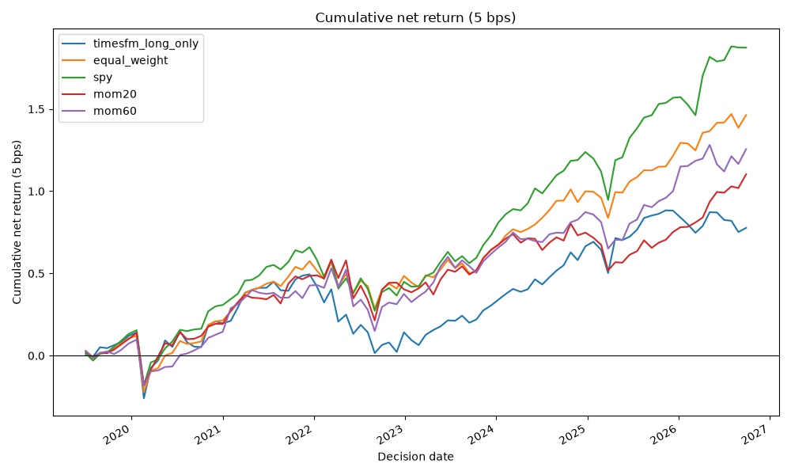
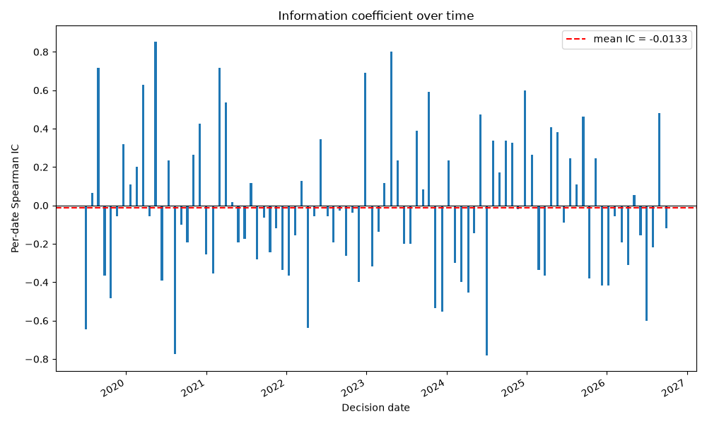
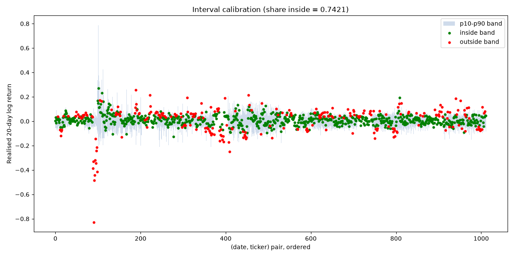
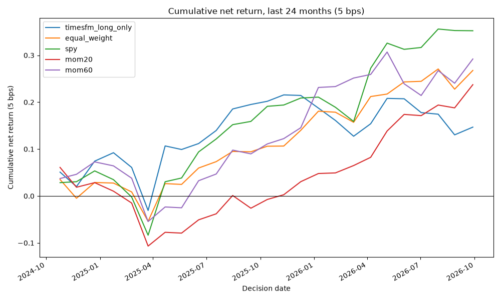

# Recommendation: No-Go

## Rationale

C1 Ranking accuracy: FAIL; C2 Beats momentum: FAIL; C3 Net portfolio performance: FAIL; C4 Beats chance: FAIL; C5 Risk: PASS; C6 Cost robustness: FAIL; C7 Interval calibration: PASS; C8 Stability: FAIL (required metric unavailable (yearly share is undefined when total net excess <= 0)); C9 Delivery: PASS. Decision: No-Go: criterion 4 failed; No-Go: mean_ic <= 0 (or unavailable); No-Go: beats neither SPY nor equal-weight on 5 bps net excess.

## Scorecard

| Number | Name | Metric value | Threshold | Passed | Note |
| --- | --- | --- | --- | --- | --- |
| 1 | Ranking accuracy | mean_ic=-0.0133, t=-0.3403 | mean_ic>=0.05 and t>=1.65 | FAIL |  |
| 2 | Beats momentum | mean_ic=-0.0133, mom20_ic=-0.0214, mom60_ic=0.0021, sharpe=0.4652, sharpe_mom20=0.6425, sharpe_mom60=0.7155 | mean_ic>mom20_ic and mean_ic>mom60_ic and sharpe>sharpe_mom20 and sharpe>sharpe_mom60 | FAIL |  |
| 3 | Net portfolio performance | sharpe=0.4652, sharpe_ew=0.7783, sharpe_spy=0.8711, excess_ew_5=-0.6860, excess_spy_5=-1.0958 | sharpe>sharpe_ew and sharpe>sharpe_spy and excess_ew_5>0 and excess_spy_5>0 | FAIL |  |
| 4 | Beats chance | random_percentile=8.6000 | random_percentile>=90 | FAIL |  |
| 5 | Risk | max_dd=0.3513, max_dd_ew=0.3048, diff=0.0464 | (max_dd - max_dd_ew) <= 0.05 | PASS |  |
| 6 | Cost robustness | excess_ew_10=-0.7629, excess_spy_10=-1.1724 | excess_ew_10>0 and excess_spy_10>0 | FAIL |  |
| 7 | Interval calibration | calibration=0.7421 | 0.70 <= calibration <= 0.90 | PASS |  |
| 8 | Stability | first_half(ic=-0.0261, ew=-0.3502, spy=-0.3250), second_half(ic=-0.0006, ew=-0.0812, spy=-0.4003), last_24m(ic=-0.0036, ew=-0.1209, spy=-0.2055), yearly_share_ew=nan, yearly_share_spy=nan | both halves: ic>0 and excess_ew>0 and excess_spy>0; yearly_share_ew<=0.5 and yearly_share_spy<=0.5 | FAIL | required metric unavailable (yearly share is undefined when total net excess <= 0) |
| 9 | Delivery | delivery_complete=True | delivery_complete is True | PASS |  |

## Sub-period results (reported separately from full period)

- Full period: mean_ic=-0.0133
- First half: mean_ic=-0.0261, net excess vs equal-weight=-0.3502, net excess vs SPY=-0.3250
- Second half: mean_ic=-0.0006, net excess vs equal-weight=-0.0812, net excess vs SPY=-0.4003
- Last 24 months: mean_ic=-0.0036, net excess vs equal-weight=-0.1209, net excess vs SPY=-0.2055

## Charts

## Data-leakage caveat

TimesFM pretraining may overlap the backtest period. The model's pretraining corpus and cut-off are not fully transparent, so some of the sector price history used for evaluation here may also have been seen during pretraining. Any apparent skill should be read with that possible overlap in mind.

## Small-sample caveat

The backtest spans roughly 90 non-overlapping rebalances, which gives limited statistical power. A criterion that passes is encouraging evidence, not proof of alpha; results could reverse out of sample.

## Model and cost caveats

Turnover is measured on target weights at each rebalance and ignores intra-period drift, so realised turnover (and therefore cost) may differ. The secondary long-short view carries no borrow or financing cost. Prices are free adjusted-close data and TimesFM is used strictly zero-shot (no fine-tuning). This report is not investment advice.

The long-short portfolio (`timesfm_long_short`) is a SECONDARY view that is NOT used in scoring or in the recommendation; where long-short data is present it is shown separately in the results tables only.
